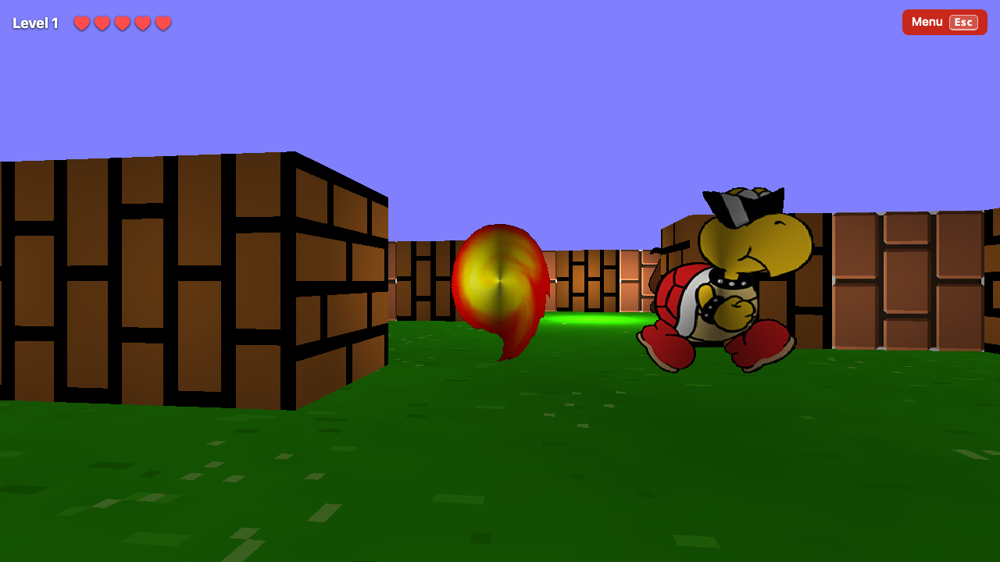
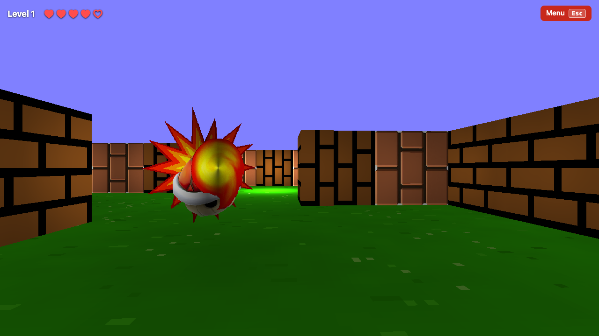

# Escape the Maze

A first-person maze game with Mario characters, written in plain WebGL 1 and JavaScript with no libraries and no build step. The maze is built from textured cubes; the Goombas, Koopas and Bob-ombs are flat sprites that always turn to face you, which is why the original README called it 2.5D.

Michael Perez made it in spring 2020 as his final project for a computer graphics course at Florida Polytechnic University, starting from the course's WebGL texture example (see [Credits](#credits)). It was revised in 2026.

**[Play it in your browser](https://michaelperez023.github.io/escape-the-maze/)** (a keyboard is required) · [Gameplay video from 2020](https://youtu.be/5lfsQRtfBVY)



| Title screen | A Koopa defeated |
| --- | --- |
|  |  |

## How to play

Pick a level, find the gap in the maze's outer wall and walk out through it. Touching an enemy sends you back to the start, and so does losing all five hearts to the shells that Koopas throw at you. Your shots defeat enemies: in Level 1 a Goomba takes 3 hits, a Koopa 2 and a Bob-omb 1; each enemy takes one more hit in Level 2 and two more in Level 3.

| Key | Action |
| --- | --- |
| <kbd>W</kbd> or <kbd>↑</kbd> | walk forward |
| <kbd>S</kbd> or <kbd>↓</kbd> | walk back |
| <kbd>A</kbd> <kbd>D</kbd> or <kbd>←</kbd> <kbd>→</kbd> | turn left, right |
| <kbd>Z</kbd> <kbd>X</kbd> | step left, right |
| <kbd>Space</kbd> | shoot |
| <kbd>Esc</kbd> | title menu |
| <kbd>Enter</kbd> | next level, after finishing one |

The title menu also sets the walking and turning speed, the projectile (fireball, ink splatter or banana, which differ only in looks) and the sound, which turns both the background music and the sound effects on or off. The music plays during the levels and pauses on the title menu.

All three levels use the same maze, placed in three areas of one world: Level 2 is the maze mirrored front to back and Level 3 mirrored left to right, so the route from the start to the exit is the same. The enemies get tougher from level to level, and the second and third mazes are darker because all ten lights are in the first.

## Running it locally

Most browsers do not let WebGL use images when the page is opened as a file, so serve the folder over HTTP:

```sh
python3 -m http.server
```

and open <http://localhost:8000/>. Any static file server works; there is nothing to build.

## How it works

| File | Contents |
| --- | --- |
| `index.html` | the page, the title menu and the GLSL vertex and fragment shaders |
| `webgl_interface.js` | compiles and links the shaders and looks up their inputs |
| `BasicGameObject.js` | the game objects: `Camera` (the player), `Quad` (enemies, projectiles and explosions), `Block` and `Walls` (the maze) and `Ground` |
| `main.js` | the game loop, levels, keyboard input and the on-screen text |
| `maze.js` | the maze layout, where each level's copy sits, enemy health and the lights |
| `textures.js` | loads the PNG textures in `assets/` and draws the grass, ink splatter and explosion |
| `sounds.js` | plays the background music, `assets/song.mp3`, and synthesizes the sound effects with the Web Audio API |

Drawing:

- There is no matrix library. The vertex shader builds the object's rotation and translation, the camera's view and the perspective projection from a few uniforms.
- Each sprite is a flat square that a look-at matrix turns towards the camera. Its texture's transparent parts are cut out in the fragment shader (texels that are not fully opaque are discarded), so sprites need no sorting or blending.
- Lighting is an ambient term, one directional light and ten point lights whose strength falls off with distance. The normals are "fake": each vertex's direction from the centre of its object, so cubes are shaded like rounded shapes.
- The 996 wall cubes are drawn with two draw calls, one per wall texture. Their vertices sit in two vertex buffers, with each cube's position as an extra vertex attribute.
- Textures use nearest-neighbour filtering, which keeps the pixel look up close.

Game logic:

- The logic runs at a fixed 60 steps per second whatever the display's refresh rate: each frame runs as many steps as real time has passed, then draws once.
- Collisions are tested in the floor plane. The player is a circle of radius 0.4 and a wall is the 2×2 square under its cube; a grid of maze cells means each test only looks at the few blocks nearby. The player slides along walls rather than stopping.
- Goombas walk back and forth and turn around at walls. Koopas and Bob-ombs wander and pick a new direction when they meet a wall or their maze's exit, so every enemy stays in its own maze. A Koopa throws a shell at most every 50 steps (0.83 s), when the player is in its maze, within 30 units and in a clear line.

Sound:

- A shot hitting an enemy makes a burst of filtered noise with crackles, and a shell hitting a wall or the player makes a falling two-tone ping. Both fade with distance from the player.
- The background music is downloaded the first time a level starts with sound on, so the page loads no audio before then. It is decoded with the Web Audio API and loops without a gap, skipping the silence at the start and end of the file. It keeps playing through the completion screen and the next level, pauses on the title menu and while the tab is hidden, and resumes where it stopped. It plays quieter than the sound effects at full volume.

## Tests

`tests/smoke.mjs` serves the folder and opens the game in headless Chrome. It runs five minutes of game time and checks that every enemy is still in its own maze. It checks that the music is not downloaded before a level starts with sound on. Counting the copies of the song that are playing and measuring the game's sound output, it checks that one copy plays during a level and keeps playing through the completion screen and the next level, that the title menu is silent, that the music resumes where it stopped and that nothing plays with sound off. Then for each level it checks that a breadth-first search with the game's own wall test can reach the exit from the start, starts the level, walks and shoots. It fails on any console error, page error or failed request. GitHub Actions runs it on every push, with WebGL rendered in software (SwiftShader). To run it locally:

```sh
npm install --no-save puppeteer-core
node tests/smoke.mjs
```

Set `CHROME_PATH` if Chrome is not installed in the usual place.

## Credits

- The starting point was the course's WebGL texture example (SimpleTextureExample): `webgl_interface.js`, the structure of the shaders, and the `Transform` and `GameObject` classes with the update and render loop are based on it.
- Fan project, not affiliated with or endorsed by Nintendo; Mario characters are trademarks of Nintendo. The Goomba, Koopa, Bob-omb, shell, fireball and banana sprites and the two brick textures are kept from the 2020 version.
- The sound effects are synthesized, and the grass, ink splatter and explosion textures are drawn, by the code in this repository.
- The background music, `assets/song.mp3`, is the one the 2020 version used; its source is not recorded.

There is no license file, because the repository includes the course's starter code and Nintendo's characters.
