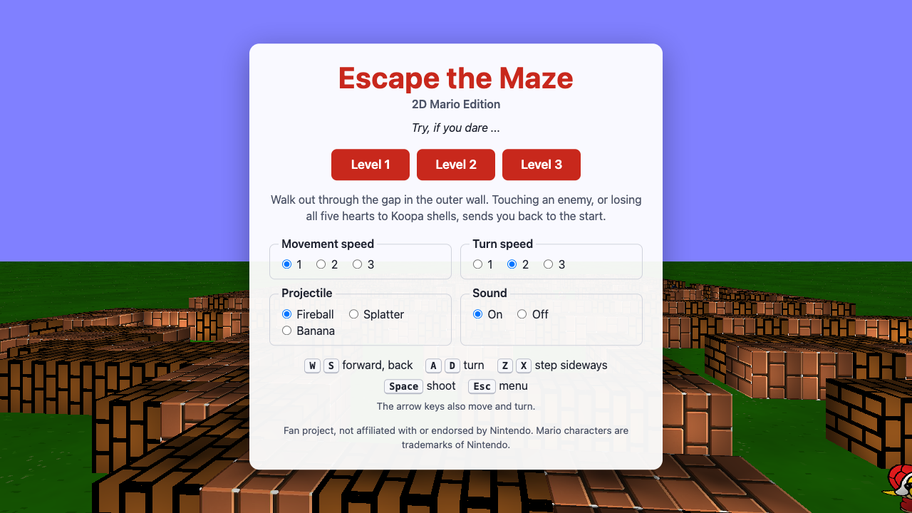

# Escape the Maze

A first-person maze game with Mario characters, written in plain WebGL 1 and JavaScript with no libraries and no build step. The maze is built from textured cubes; the Goombas, Koopas and Bob-ombs are flat sprites that always turn to face you, which is why the original README called it 2.5D.

Michael Perez made it in spring 2020 as his final project for a computer graphics course at Florida Polytechnic University, starting from the course's WebGL texture example (see [Credits](#credits)). It was revised in 2026; see [Changes since the 2020 version](#changes-since-the-2020-version).

**[Play it in your browser](https://michaelperez023.github.io/escape-the-maze/)** (a keyboard is required) · [Gameplay video from 2020](https://youtu.be/5lfsQRtfBVY)


| Title screen | A Koopa defeated |
| --- | --- |
|  |  |

## How to play

Pick a level, find the gap in the maze's outer wall and walk out through it. Touching an enemy sends you back to the start, and so does losing all five hearts to the shells that Koopas throw at you. Your shots defeat enemies: in Level 1 a Goomba takes 3 hits, a Koopa 2 and a Bob-omb 1; each enemy takes one more hit in Level 2 and two more in Level 3.

| Key | Action |
| --- | --- |
| <kbd>W</kbd> or <kbd>↑</kbd> | walk forward |
| <kbd>S</kbd> or <kbd>↓</kbd> | walk back |
| <kbd>A</kbd> <kbd>D</kbd> or <kbd>←</kbd> <kbd>→</kbd> | turn left, right |
| <kbd>Z</kbd> <kbd>X</kbd> | step left, right |
| <kbd>Space</kbd> | shoot |
| <kbd>Esc</kbd> | title menu |
| <kbd>Enter</kbd> | next level, after finishing one |

The title menu also sets the walking and turning speed, the projectile (fireball, ink splatter or banana, which differ only in looks) and the sound.

All three levels use the same maze, placed in three areas of one world: Level 2 is the maze mirrored front to back and Level 3 mirrored left to right, so the route from the start to the exit is the same. The enemies get tougher from level to level, and the second and third mazes are darker because all ten lights are in the first.

## Running it locally

Most browsers do not let WebGL use images when the page is opened as a file, so serve the folder over HTTP:

```sh
python3 -m http.server
```

and open <http://localhost:8000/>. Any static file server works; there is nothing to build.

## How it works

| File | Contents |
| --- | --- |
| `index.html` | the page, the title menu and the GLSL vertex and fragment shaders |
| `webgl_interface.js` | compiles and links the shaders and looks up their inputs |
| `BasicGameObject.js` | the game objects: `Camera` (the player), `Quad` (enemies, projectiles and explosions), `Block` and `Walls` (the maze) and `Ground` |
| `main.js` | the game loop, levels, keyboard input and the on-screen text |
| `maze.js` | the maze layout, where each level's copy sits, enemy health and the lights |
| `textures.js` | loads the PNG textures in `assets/` and draws the grass, ink splatter and explosion |
| `sounds.js` | sound effects, synthesized with the Web Audio API |

Drawing:

- There is no matrix library. The vertex shader builds the object's rotation and translation, the camera's view and the perspective projection from a few uniforms.
- Each sprite is a flat square that a look-at matrix turns towards the camera. Its texture's transparent parts are cut out in the fragment shader (texels that are not fully opaque are discarded), so sprites need no sorting or blending.
- Lighting is an ambient term, one directional light and ten point lights whose strength falls off with distance. The normals are "fake": each vertex's direction from the centre of its object, so cubes are shaded like rounded shapes.
- The 996 wall cubes are drawn with two draw calls, one per wall texture. Their vertices sit in two vertex buffers, with each cube's position as an extra vertex attribute.
- Textures use nearest-neighbour filtering, which keeps the pixel look up close.

Game logic:

- The logic runs at a fixed 60 steps per second whatever the display's refresh rate: each frame runs as many steps as real time has passed, then draws once.
- Collisions are tested in the floor plane. The player is a circle of radius 0.4 and a wall is the 2×2 square under its cube; a grid of maze cells means each test only looks at the few blocks nearby. The player slides along walls rather than stopping.
- Goombas walk back and forth and turn around at walls. Koopas and Bob-ombs wander and pick a new direction when they meet a wall or their maze's exit, so every enemy stays in its own maze. A Koopa throws a shell at most every 50 steps (0.83 s), when the player is in its maze, within 30 units and in a clear line.
- A shot hitting an enemy makes a burst of filtered noise with crackles, and a shell hitting a wall or the player makes a falling two-tone ping. Both fade with distance from the player.

## Tests

`tests/smoke.mjs` serves the folder and opens the game in headless Chrome. It runs five minutes of game time and checks that every enemy is still in its own maze. Then for each level it checks that a breadth-first search with the game's own wall test can reach the exit from the start, starts the level, walks and shoots. It fails on any console error, page error or failed request. GitHub Actions runs it on every push, with WebGL rendered in software (SwiftShader). To run it locally:

```sh
npm install --no-save puppeteer-core
node tests/smoke.mjs
```

Set `CHROME_PATH` if Chrome is not installed in the usual place.

## Changes since the 2020 version

- **Loading.** The 17 textures were stored as hex arrays inside a 25 MB `BasicGameObject.js`, so the page stayed blank for several seconds while the browser parsed it. The 14 character and wall textures are now PNG files in `assets/`. They decode to exactly the same pixels as the old arrays, checked by reading every texture back from the GPU.
- **Space restarted the level.** After a level button was clicked it kept the keyboard focus, so the first press of Space (shoot) pressed the button again and put the player back at the start. Keyboard focus now moves to the game, and the game's keys no longer scroll the page or press buttons. A tap shorter than one frame still counts.
- **Level 3 had no collisions.** It started the player at a height of 5 while everything else is at 0, and collisions were tested in 3D, so the player walked through walls and enemies, and fireballs hit nothing. The player now starts on the ground, and collisions are tested in the floor plane.
- **Walls.** A wall collided like a sphere of radius 2.2 around its 2×2 cube, so the player stopped 1.3 units in front of every wall and could not enter any corridor one cell wide, although it was drawn open. Walls now collide as their cubes, and the player slides along them. Enemies now collide about as wide as they are drawn (a radius of 0.8 instead of 0.2; the sprites are 2 units wide), so they still block the narrow corridors.
- **Game speed.** Movement, shooting and animation were counted in frames, so the game ran at half speed at 30 fps and faster on displays above 60 Hz. The logic now runs 60 steps per second.
- **Frame rate.** Every frame, each enemy and projectile tested all 996 walls; each cube was its own draw call that looked up shader variables and set texture parameters; and every animation frame uploaded a new texture. The 256×256 block texture was uploaded separately for each of the 483 blocks that use it. Walls are now found through the grid, each texture is uploaded once and shared, and the walls take two draw calls.
- **Koopas and Bob-ombs** jittered against walls because their test for a free direction was inverted. They now turn to a direction that is free. They could also walk out through their maze's exit and wander away; now the exit stops them as a wall does, so each maze keeps its own enemies.
- **Koopa shells** flew in the direction opposite to where the player was looking, not at the player, and all 15 Koopas threw them all the time, in all three mazes and behind the title menu. Koopas now aim at the player, and only in the current level when the player is in range and in sight.
- **Enemy health.** The code set enemy health by level, but it ran when the level number was still 0, so it never applied, and the fallback values made Level 2 tougher than Level 3. Enemies now take 3, 4 and 5 hits (Goomba), 2, 3 and 4 (Koopa) and 1, 2 and 3 (Bob-omb) in Levels 1, 2 and 3, as the code intended.
- **Level flow.** Starting a level did not reset the message under the game, and the title menu left the level running behind it, so "Level 2 completed!" could appear while playing Level 1. Finishing a level only changed that message. Now a completion screen shows the time with buttons for the next level and the title menu, and starting a level resets its enemies and the player's health.
- **Grass.** The grass texture's edge texels were slightly transparent, so the shader discarded them and the sky showed through as lines across the ground every 20 units. The new grass texture is fully opaque.
- **Screen.** The canvas was fixed at 1400×650 pixels with a projection for a 5:3 frame, so the picture was stretched and did not fit smaller windows. It now fills the window without stretching. It is drawn at the screen's pixel density up to about 1920×1080 pixels in all, and without multisampling, which on large screens cost more than all the other drawing; this keeps the game at 60 fps on integrated graphics. On phones and tablets without a keyboard, the title screen says that a keyboard is required.
- **Smaller fixes.** Exploding enemies no longer send the player back to the start. Projectiles that hit nothing disappear after 10 seconds. The depth buffer is cleared every frame. Keys are read by their position on the keyboard (`KeyboardEvent.code`; `keyCode` is deprecated), the arrow keys work, and keys held when the window loses focus are released. The shaders passed 12 varyings to each other, more than the 8 that every WebGL implementation must support; now they pass 3. Until the first click or key press, the 2020 page logged a console error each time a shell hit a wall behind the title menu, because browsers block sound before then; now no sound plays before a level starts. The page also has a favicon now; its absence logged a 404 error.
- **Assets.** The sources of the music and the two sound effect files could not be confirmed, so they were removed; the sound effects are now synthesized. The grass, ink splatter and explosion images were clip art of unknown origin; they are now drawn by `textures.js`.
- **Other changes.** The default turning speed is the middle setting (the default was the slowest, 34° per second at 60 frames per second). Projectiles and shells are drawn at half the size of the characters. For a second after the player is sent back to the start, enemies cannot touch them, in case one has wandered onto the start. The title screen has a new layout that lists the controls and has a sound setting, and health is shown as hearts. The inline script moved to `main.js` and `maze.js`, and the three identical copies of the maze in the code are now one. `SimpleTextureExample.html` was renamed `index.html`.

Measured back to back in headless Chrome 157 on a Mac with Intel UHD Graphics 630, 11 runs each in three sessions with more or less other work running on the machine. The 2020 version's frame rate depends a lot on that load:

| | 2020 version | Now |
| --- | --- | --- |
| Files loaded before the menu works | 25.2 MB | 0.46 MB |
| Time until the level buttons work | 2.2 to 5.2 s | 0.29 to 0.74 s |
| Frame rate in Level 1 | 16 to 56 fps | 60 fps (the display's rate) |
| Longest pause between two frames | 34 to 250 ms | 17 ms |
| Game logic per frame | 12 to 40 ms | 0.06 to 0.11 ms |
| Drawing per frame, until the GPU finishes | 5 to 20 ms | 0.13 to 0.22 ms |

## Credits

- The starting point was the course's WebGL texture example (SimpleTextureExample): `webgl_interface.js`, the structure of the shaders, and the `Transform` and `GameObject` classes with the update and render loop are based on it.
- Fan project, not affiliated with or endorsed by Nintendo; Mario characters are trademarks of Nintendo. The Goomba, Koopa, Bob-omb, shell, fireball and banana sprites and the two brick textures are kept from the 2020 version.
- The sound effects are synthesized, and the grass, ink splatter and explosion textures are drawn, by the code in this repository.

There is no license file, because the repository includes the course's starter code and Nintendo's characters.
